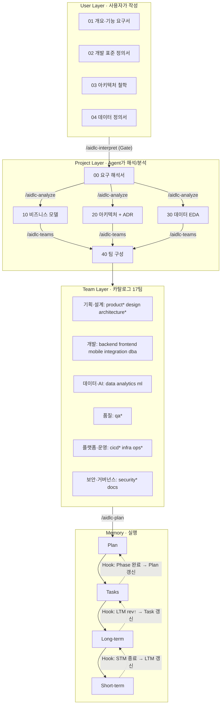

# AI-DLC 실험 저장소

📖 **사용 설명서: [docs/aidlc/README.md](docs/aidlc/README.md)**

사용자가 **템플릿에 맞춰 문서를 쓰면**, Agent 가 이를 해석해서 분석 → 팀 생성 → 계획 → 실행까지 진행하는 **AI-Driven Development Life Cycle** 을 Claude Code 기본 기능(Subagent · Skill · Hook)만으로 구현했습니다.

## 전체 흐름



## 빠른 시작

`/aidlc-*` 는 **Claude Code 채팅 입력창**에 입력하는 명령입니다 (터미널 아님). VSCode 에서 이 저장소 최상위 폴더를 열고 Claude Code 패널에서 `/` 를 치면 목록이 나옵니다. 자세히: [시작하기](docs/aidlc/01-getting-started.md#명령은-어디에-입력하나요)

```text
/aidlc-init            # workspace/ 생성 (User 템플릿 4종 + 메모리 4종)
# workspace/user/*.md 작성 — {{ }} 가 필수 항목
/aidlc-interpret       # Gate 검사 → doc-interpreter 가 00 해석서 + 질문 목록
/aidlc-analyze         # business / data (병렬) → architecture → 교차 검증
/aidlc-teams           # core 6팀 + 조건부 팀 → teams/<id>/charter.md + .claude/agents/team-<id>.md
/aidlc-plan            # plan.md (Phase) + tasks.md (Task) + LTM 시드
/aidlc-run 3           # Task 3개: STM 열기 → 팀 Agent → 리뷰 게이트 → STM 닫기 → cascade
/aidlc-docs            # API 탐지 → REST API 레퍼런스 자동 생성 + API 가이드 + 사용자 가이드
/aidlc-status          # 현재 위치와 다음 명령
```

## 구성

```
CLAUDE.md                        운영 규칙 (계층, 소유권, cascade)
.claude/
  settings.json                  Hook 등록 (SessionStart, PostToolUse, Stop, PreCompact)
  agents/                        doc-interpreter, business-analyst, architecture-analyst,
                                 data-analyst, team-architect, memory-curator (+ 생성되는 team-*)
  skills/aidlc-*/SKILL.md        파이프라인 명령 7종
aidlc/
  templates/user|project|team|memory/   모든 문서 템플릿
  hooks/memory_cascade.py        메모리 cascade 엔진 (표준 라이브러리만 사용)
  teams/catalog.json             팀 카탈로그 17팀 (core 6)
  scripts/aidlc.py               init / check / teams / new-team / status
  scripts/openapi_docs.py        OpenAPI 3.x → REST API 레퍼런스 Markdown
  examples/                      샘플 챗봇 OpenAPI 명세
  tests/                         cascade 엔진 테스트
docs/aidlc/                      프레임워크 사용 설명서 (+ examples/ 생성 예시)
docs/api, docs/guide             ← /aidlc-docs 가 생성하는 프로젝트 문서
workspace/                       ← /aidlc-init 이 생성하는 실제 프로젝트 인스턴스
workspace-exam/                  완성된 예시 (AI-DLC 로 만든 AI-DLC Monitor 의 전 산출물, 읽기 전용 — Hook 대상 아님)
```

## 팀 카탈로그

`aidlc/teams/catalog.json` 에 실제 조직에서 운영되는 17개 팀이 정의돼 있습니다. 팀마다 미션, 소유 범위, 산출물, 입력 문서, 협업 대상, DoD, 품질 지표, **리뷰 게이트**, Agent 지침이 들어 있고, `new-team` 이 이 값으로 charter 와 팀 Agent 를 생성합니다.

| 그룹 | 팀 (`*` = core, 항상 생성) |
|------|-----------------------------|
| 기획·설계 | product* (PO/PM), design (UX/UI), architecture* |
| 개발 | backend, frontend, mobile, integration (외부 연동), dba |
| 데이터·AI | data (Data Eng), analytics (BI), ml (ML/AI·LLM·RAG) |
| 품질 | qa* (QA/Test) |
| 플랫폼·운영 | cicd*, infra (Cloud/IaC), ops* (SRE) |
| 보안·거버넌스 | security* (DevSecOps), docs (Tech Writing) |

```bash
python3 aidlc/scripts/aidlc.py teams              # 카탈로그 보기
python3 aidlc/scripts/aidlc.py new-team --core    # core 6팀 생성
python3 aidlc/scripts/aidlc.py new-team ml data   # 조건부 팀 추가
```

팀 Agent 는 **작업 모드**와 **리뷰 모드**로 동작합니다. `/aidlc-run` 은 Task 를 담당 팀에 맡긴 뒤, 변경 내용이 리뷰 게이트 대상에 해당하는 팀들(코드 변경이면 qa 는 항상)이 독립적으로 검증하고 나서야 STM 을 닫습니다.

## 메모리 계층과 Hook

| 계층 | 파일 | 수명 | 갱신 조건 (Hook 이 판정하는 frontmatter) |
|------|------|------|------------------------------------------|
| Plan | `plan.md` | 프로젝트 | Phase 의 Task 가 모두 `[x]` 인데 `completed_phases` 에 없음 |
| Tasks | `tasks.md` | Phase | LTM `rev` > `synced_ltm_rev` |
| Long-term | `long-term.md` | 프로젝트 | 아카이브된 STM 번호 > `last_merged_stm` |
| Short-term | `short-term.md` | Task 1개 | `status: closed` → 아카이브 후 초기화 |

| Hook 이벤트 | 동작 |
|-------------|------|
| SessionStart | 현재 Plan/Task/LTM/STM 상태와 미처리 cascade 를 컨텍스트에 주입 |
| PostToolUse (Write/Edit) | 메모리 파일이 바뀌면 STM 아카이브 처리 + 다음 cascade 단계 지시 |
| Stop | 미처리 cascade 가 있으면 종료 차단 (무한 루프 방지: 연속 3회 후 허용) |
| PreCompact | 진행 중 STM 스냅샷 저장 (`archive/snapshots/`) |

판정은 전부 파일 값으로 하므로 결정적입니다. LLM 은 "무엇을 쓸지"만 판단하고, "언제 갱신할지"는 Hook 이 강제합니다.

## 테스트

```bash
python3 -m unittest discover -s aidlc/tests -v
```
