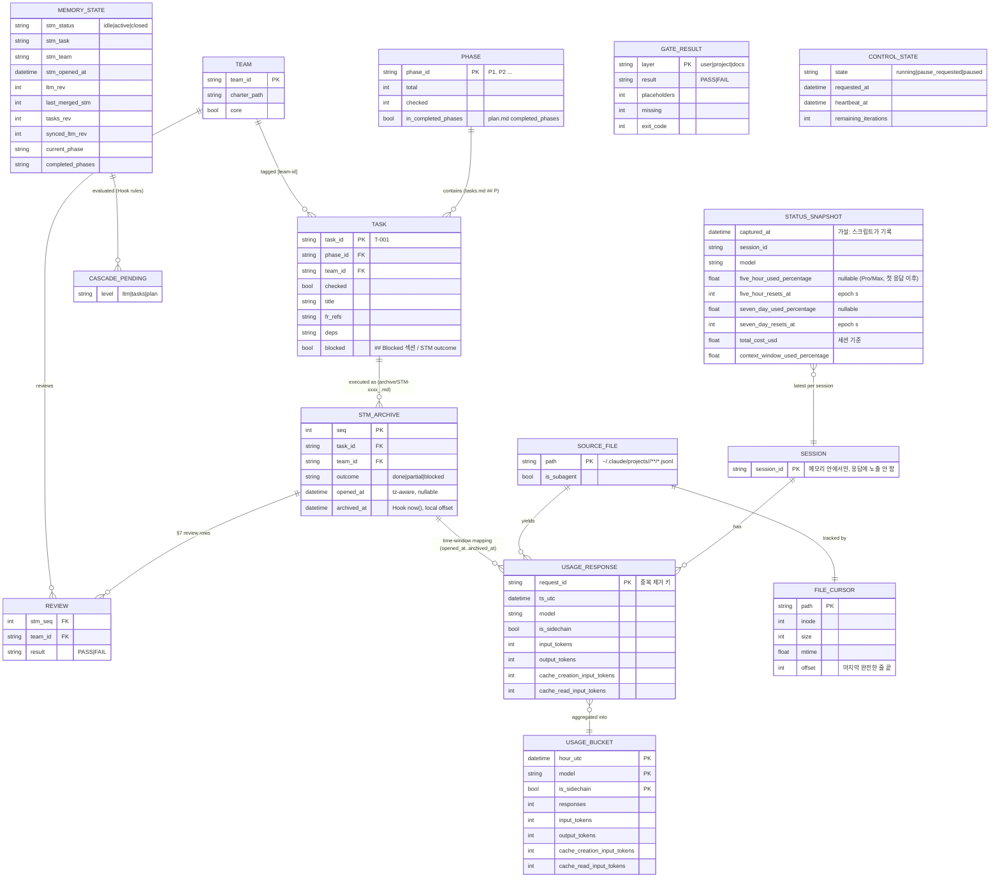

# 30. 데이터 분석 (EDA)

> 입력: user/04, 00-interpretation.md(§4 답변 적용, 특히 Q2 개인정보 규칙), 실제 데이터.
> 분석 코드·결과: `workspace/project/eda/` — `profile_usage.py`(DS-03) → `summary_usage.json`, `profile_workspace.py`(DS-01·02·05) → `summary_workspace.json`, `bench_real.py` → `summary_bench_real.json`, `bench_synthetic.py` → `summary_bench.json`, `prefilter_check.py` → `summary_prefilter.json`. 모두 표준 라이브러리만 사용.
> **측정 시점:** 2026-10-23 07:13 UTC (`summary_usage.json` 의 `generated_at_utc`). DS-03 은 지금 진행 중인 세션이 계속 쓰고 있는 파일이라 다시 실행하면 수치가 늘어난다.
> **실측 / 가설 구분:** DS-01·02·03 = 실측. DS-04 = **가설 기반**(스냅샷 파일 아직 없음). DS-05 = 실측했지만 데이터가 아직 없음(팀 단계 미실행).
> **개인정보 처리 (00 §4 Q2):** DS-03 의 각 줄은 원문 텍스트로 읽고, `"usage"` 문자열이 없으면 json 파싱 전에 버렸다. 파싱한 줄에서는 `timestamp`, `requestId`, `message.model`, `message.usage` 숫자 4종, `isSidechain`, `sessionId` 만 복사하고 원본 객체는 바로 버렸다. 결과 파일에는 개수와 합계만 있고, 본문·ID 값·파일 경로는 들어가지 않는다.

## 1. 데이터 소스 프로파일
| DS | 행/열 수 | 기간 | 결측률 | 중복률 | 주요 타입 | 비고 |
|----|----------|------|--------|--------|-----------|------|
| DS-01 메모리 | 파일 4개(합계 4,277 B), frontmatter 키: plan 2 / tasks 2 / LTM 2 / STM 5. tasks 체크박스 1줄(P1 1개, 0 완료), archive 0건, snapshots 0건 | 2026-10-23 05:59~06:08 (파일 mtime) | STM 키 5개 중 4개가 `none` 문자열(idle 상태라 정상). 그 밖에는 0% | 해당 없음 | int(rev, synced_ltm_rev, last_merged_stm), list(completed_phases), str(status 등) | 초기화 직후 템플릿 상태. tasks.md 의 `T-001 [backend] 예시 Task` 는 템플릿 예시 줄인데 Hook 은 실제 Task 로 센다. `.cascade-state.json`·`.control.json` 없음 |
| DS-02 Gate/status | `status` 7줄(exit 0, 0.069 s), `check user` 6줄(exit 0), `check project` 7줄(exit 1, 측정 시점 MISSING 3), `check docs` 2줄(exit 0). 각 0.03 s 안팎 | 조회 시점 | 0% (모든 줄이 `OK/MISSING ... (n개 미작성)` 또는 `GATE PASS/FAIL — ... 미작성 n개, 누락 문서 n개` 정규식에 맞음, 못 읽은 줄 0) | 해당 없음 | 텍스트, exit code | **`status` 는 읽기 전용이 아니다**: `memory_cascade.handle("status")` 가 `archive_stm_if_closed()` 를 먼저 부른다(§3). `check` 는 쓰기 없음 |
| DS-03 세션 기록 | 파일 4개(main 1 + `subagents/` 3), 3,494,823 B, 900줄. `"usage"` 문자열 있는 줄 342, 그중 `message.usage` 있는 줄 302(전체의 33.6%). 고유 응답(requestId) 127, 세션 1개. 뽑아낸 필드 9개 | 2026-10-23 05:56:32 ~ 07:13:02 UTC (1.28 시간) | 뽑아낸 9개 필드 모두 0% (302줄) | **줄 기준 57.95%** (302줄 → 고유 127개, 중복 줄 175개) | ISO-8601 UTC(`Z`) 문자열, int 토큰 4종, bool, 문자열 ID | `"usage"` 문자열은 있지만 `message.usage` 가 없는 줄이 40개(문자열 있는 줄의 11.7%, 도구 결과·서브에이전트 결과 등). 한 줄 최대 235,954 B |
| DS-04 상태 스냅샷 | 0 (파일 없음) | - | - | - | (가설) §5 STATUS_SNAPSHOT 참고 | **가설 기반.** status line 을 아직 등록하지 않음(00 A4·Q4 가 구현 Task) |
| DS-05 팀 정의 | `workspace/teams/` 폴더는 있으나 비어 있음(charter 0개), `40-team-composition.md` 없음, `.claude/agents/team-*.md` 0개. 카탈로그 `aidlc/teams/catalog.json` 17팀 | - | 100% (팀 단계 미실행) | - | Markdown | `/aidlc-teams` 를 실행한 뒤에 채워진다 |

## 2. 데이터 품질 평가
| 차원 | 상태 (양호/주의/불량) | 근거 | 조치 |
|------|----------------------|------|------|
| 완전성 | 주의 | DS-03 은 필드 결측 0%(302줄). 하지만 DS-04 파일 없음, DS-01 archive 0건, DS-05 팀 0개라서 FR-004 한도·비용, FR-007, 04 Q3 는 아직 데이터가 없다 | 패널마다 "데이터 없음" 상태를 정의한다(NFR-002). DS-04 는 status line Task 에서 만든다. Q3 는 첫 `/aidlc-run` 이후 다시 분석 |
| 정확성 | 주의 | 중복을 지우지 않고 더하면 토큰이 2.29~2.73배로 부풀려진다(input 2.348×, output 2.725×, cache_creation 2.571×, cache_read 2.290×). `"usage"` 문자열 사전 필터는 거짓 양성이 11.7% | requestId 중복 제거를 반드시 한다(§6 정제). 사전 필터를 통과해도 `message.usage` 가 dict 인지 다시 확인 |
| 일관성 | 주의 | JSONL `timestamp` 는 UTC `Z`(고유 응답 127건 중 파싱 실패 0). Hook 의 `archived_at` 은 `now()` = 로컬 오프셋 ISO, STM `opened_at` 은 오케스트레이터가 쓰는 ISO 문자열이거나 `none`. tasks.md 에 템플릿 예시 Task 가 남아 있음 | 모든 시각을 tz-aware 로 파싱한 뒤 UTC 로 비교. `none`·파싱 실패는 "시각 없음"으로 처리. 예시 Task 는 `/aidlc-plan` 에서 사라짐 |
| 적시성 | 양호 | DS-03 은 응답마다 줄이 추가된다(측정 중에도 3,244,400 B → 3,494,823 B 로 늘어남). DS-01 은 Hook 이 바로 갱신. DS-04 갱신 주기는 미확인(가설: 메시지마다) | 파일 size·mtime 을 1~2초 간격으로 확인하고 증분으로 읽으면 5초 안에 반영 가능(§3 증분 1 MB ≈ 1.4~1.7 ms) |
| 유일성 | 불량 → 정제 후 양호 | 302줄 중 175줄이 중복(57.95%). requestId 그룹 크기 분포 {1:32, 2:33, 3:52, 4:5, 5:3, 6:1, 7:1}. 중복 그룹 95개 모두 usage 4종 값이 같고, 모델도 같고, 파일을 넘나드는 중복은 0 | 중복 제거 규칙(§6)을 쓰면 고유 127건으로 확정된다 |

**종합 등급: B (쓸 수 있음, 정제 규칙 필수).** DS-03 의 구조 품질은 좋지만(결측 0, 파싱 실패 0) 중복이 커서 정제 없이 쓰면 안 된다. 나머지 소스는 형식은 깨끗하지만 아직 데이터가 쌓이지 않았다.

## 3. 주요 관찰 (분포 / 이상치 / 상관)
- **중복 구조:** 고유 응답 127개 중 95개(74.8%)가 여러 줄로 기록되었다(최대 7줄). 중복 그룹 95개 모두 usage 4종이 같으므로(`dup_groups_usage_identical` = 95, `dup_groups_field_differs` = {}), 응답 하나가 내용 블록(사고/텍스트/도구 호출)마다 같은 usage 를 달고 따로 기록되는 것으로 보인다. 그래서 "마지막 줄 채택"과 "처음 본 줄 채택"의 결과가 같다.
- **토큰 구성 (중복 제거 후):** cache_read 23,810,762 (97.2%) / cache_creation 425,291 (1.7%) / output 254,717 (1.0%) / input 264 (0.001%). 순수 input 은 거의 0이고 입력은 대부분 캐시를 거친다. 그래서 "입력 토큰" 그래프에는 반드시 캐시 2종을 함께 보여 줘야 의미가 있다.
- **캐시 적중률:** 전체 98.24%. 메인 대화(isSidechain=false, 100건) 98.84%, 서브에이전트(isSidechain=true, 27건) 85.53%. 서브에이전트는 새 컨텍스트로 시작하므로 cache_creation 비중이 높다(156,487 / 1,081,525 = 14.5%).
- **메인과 서브에이전트:** 서브에이전트 기록은 `<세션>/subagents/agent-*.jsonl` 로 따로 저장되고, 메인 파일과 겹치는 requestId 는 0개다. 따라서 하위 폴더까지 재귀로 읽어야 빠지는 토큰이 없다(서브에이전트 몫: output 57,969 = 전체 output 의 22.8%).
- **시간 분포 (UTC 시각 단위, 중복 제거 후):** 05시 4건 / 352,779 토큰, 06시 75건 / 16,414,151 토큰, 07시(13분까지) 48건 / 7,724,104 토큰. 세션 하나, 1.28시간짜리 표본이라 하루 중 패턴을 말할 수는 없다. 이 장비는 TZ=UTC 라 로컬 시각과 UTC 가 같다.
- **기록 크기:** 시간당 2.74 MB, 응답당 약 27.5 KB. 바이트 비중은 usage 줄 45.1%, 사전 필터 거짓 양성 줄 20.4%(평균 20.6 KB, 큰 도구 결과), 나머지 34.5%(`summary_bench.json` 의 `category_byte_share`).
- **사전 필터 선택도 (`summary_prefilter.json`):** `usage` 338줄 맞음(usage 레코드 299, 측정 시점) → `"usage":` 301줄 → `"usage":{"input_tokens"` 299줄. 마지막 후보는 거짓 양성이 0이지만 키 순서에 기대므로 깨지기 쉽다. **`"usage":` 를 1차 필터로 권장**한다(Q2 규칙보다 엄격하므로 규칙을 지킨다).
- **파싱 성능:** 실제 기록 3.495 MB 를 15.4 ms(4.4 ms/MB)에 처리, 7회 반복 중앙값 3.9 ms/MB, 그중 원문 읽기와 필터만 6.0 ms. 줄 길이·범주 분포를 그대로 따른 합성 파일(본문은 가짜): 50 MB 0.069 s, 200 MB 0.272 s, 600 MB 0.808 s(1.3~1.4 ms/MB, 크기에 비례). 1 MB 를 덧붙인 뒤 증분 파싱은 1.4~1.7 ms. 합성 파일은 JSON 구조가 단순해서 실제보다 약 3배 빠르다. 그래서 외삽에는 실측 4.4 ms/MB 를 보수적인 값으로 쓴다. 측정 장비는 4 vCPU 2.7 GHz, Python 3.13.
- **DS-02 부작용 (중요):** `aidlc.py status` → `memory_cascade.py status` → `handle()` 가 요약을 출력하기 전에 `archive_stm_if_closed()` 를 부른다. STM 이 `status: closed` 이면 아카이브 파일을 만들고 short-term.md 를 초기화한다. 측정 시점에는 STM 이 idle 이라 실행 전후 memory 해시가 같았지만, 대시보드가 이 명령을 부르면 CON-03(읽기 전용)을 어기고 Hook 의 cascade 순서에도 끼어든다. **대시보드는 `status` 서브프로세스를 부르지 않고**, `read_doc`·`Memory.phases`·`Memory.archived`·`Memory.pending` 같은 읽기 전용 함수와 같은 규칙(또는 그 함수 자체)으로 판정해야 한다. `check` 는 쓰기가 없어 서브프로세스로 불러도 된다(00 A17 해소, architecture ADR 근거).
- **Hook 파싱 규칙 재현:** `profile_workspace.py` 는 Hook 모듈의 `FM_RE`, `PHASE_RE`(`^##\s+(P\d+)\b`), `CHECKBOX_RE`(`^\s*[-*]\s+\[( |x|X)\]\s+`) 를 그대로 써서 `P1 0/1` 을 얻었고, 이는 `status` 출력과 같다. `## ` 로 시작하는 Phase 가 아닌 섹션(Backlog, Blocked)의 체크박스는 Phase 집계에서 빠진다. blocked 표시는 frontmatter 가 아니라 `## Blocked` 섹션의 본문 줄과 STM `outcome: blocked` 에만 있다(FR-010 b 조건의 출처).
- 그래프 파일은 만들지 않았다(matplotlib 같은 외부 패키지를 쓰지 않음). 시간대별 수치는 `summary_usage.json` 의 `time.hourly_utc` 에 있다.

## 4. 질문별 답변 (user/04 §3)
| # | 질문 | 답 | 근거 (수치/쿼리) | 확신도 |
|---|------|-----|------------------|--------|
| 1 | 오늘, 그리고 현재 5시간 구간에 토큰을 얼마나 썼나 (입력/출력/캐시별) | 오늘(2026-10-23 UTC, 이 프로젝트 기준): input 264 / output 254,717 / cache_creation 425,291 / cache_read 23,810,762, 합계 24,491,034, 응답 127건. 최근 5시간(이동 구간)도 같은 값이다(기록이 모두 최근 1.28시간 안에 있음) | `profile_usage.py` → `q1.today_utc`, `q1.last_5h_rolling` (중복 제거 후) | 수치 H / "현재 5시간 구간"의 정의 M — 공식 구간 경계는 DS-04 `rate_limits.five_hour.resets_at`(시작 = resets_at − 5h)에서 와야 하는데 아직 없어서 이동 5시간으로 대신했다. 한도는 계정 전체 기준이고 토큰은 이 프로젝트 기준이다(00 A13) |
| 2 | 모델별 사용 비중은 어떤가 | `claude-opus-5-5` 100% (응답 127/127, 토큰 24,491,034/24,491,034). 서브에이전트도 같은 모델 | `summary_usage.json` → `models` | 표본 기준 H, 일반화 L (세션 1개·1.28시간) |
| 3 | Task 하나를 수행하는 데 평균 토큰과 시간이 얼마나 드나 (팀별) | **지금은 답할 수 없음.** STM 아카이브 0건, 팀 0개, Task 실행 기록이 없다 | `summary_workspace.json` → `archive.stm_count` = 0, `ds05_teams.charters` = 0 | 해당 없음. 필요한 데이터: `archive/STM-*.md` frontmatter(`task`, `team`, `opened_at`, `archived_at`, `outcome`) + 같은 기간의 DS-03. 방법: STM 구간 [opened_at, archived_at) 에 속한 응답의 토큰 합계(tz 를 맞춘 UTC 비교), 시간 = archived_at − opened_at. 주의: archived_at 은 Hook 이 보관한 시각이라 실제 종료보다 늦을 수 있고, 리뷰·cascade 토큰도 같은 구간에 들어간다. 다른 저장소의 세션이 섞이지 않게 이 프로젝트 폴더만 쓴다. 첫 `/aidlc-run` 몇 번 뒤에 `profile_usage.py` 를 STM 매핑까지 넓혀 다시 측정 |
| 4 | 캐시 적중률(cache_read / 전체 입력)은 얼마인가 | **98.24%** = 23,810,762 / (264 + 425,291 + 23,810,762). 메인 98.84%, 서브에이전트 85.53% | `summary_usage.json` → `cache_hit_rate`, `sidechain.tokens` | 이 세션 H, 일반 M |
| 5 | 세션 기록 파일이 클 때(수십 MB) 집계에 걸리는 시간은 얼마인가 | 수십 MB 는 0.1~0.3 s 이하다(실측 4.4 ms/MB 기준 50 MB ≈ 0.22 s, 합성 50 MB 0.069 s). 30일 외삽(시간당 2.74 MB): 하루 4시간 → 329 MB → 콜드 1.45 s(실측 기준)/0.44 s(합성 기준). 하루 8시간 → 658 MB → 2.89 s / 0.89 s. **처음 화면을 그릴 때 전량을 파싱하면 NFR-001 의 2초를 넘을 수 있다.** 증분은 1 MB 에 약 1.5 ms(실측 기준 약 4.4 ms) 라서 상태 변화 5초 반영은 여유가 크다 | `summary_bench_real.json`, `summary_bench.json` (50/200/600 MB, 3회 중 최소), 시간당 MB = 3,494,823 B / 1.275 h | M — 표본 세션은 분석 작업이었다. `/aidlc-run` 처럼 큰 도구 출력이 많은 세션은 MB/h 가 더 클 수 있다. Windows·HDD 같은 느린 장비는 2~3배 여유를 둬야 한다 |

## 5. 데이터 모델 제안
대시보드는 디스크에 자기 데이터를 남기지 않는다(03, 00 C3). 아래에서 `FILE_CURSOR`, `USAGE_RESPONSE`, `USAGE_BUCKET` 은 **프로세스 메모리 안의 파생 캐시**이고, 나머지는 원천 파일을 읽을 때마다 만드는 읽기 모델이다. `CONTROL_STATE` 만 대시보드가 쓰는 유일한 파일(`workspace/memory/.control.json`, 00 Q6)이다.

- **DS-04 스키마 (가설 기반, 00 A4):** status line 스크립트가 stdin JSON 에서 `rate_limits.five_hour.{used_percentage, resets_at}`, `rate_limits.seven_day.{used_percentage, resets_at}`, `cost.total_cost_usd`, `context_window.used_percentage`, 모델, 세션 ID 만 골라 `captured_at` 을 붙인 뒤 git 무시 경로에 원자적으로(임시 파일 → rename) 저장한다. `rate_limits` 는 Pro/Max 구독에서, 세션 첫 응답 이후에만 있으므로 모든 한도 필드는 nullable 이다. 구현 첫 Task 에서 실제 stdin 키 이름과 단위(퍼센트 0~100인지 0~1인지, resets_at 이 epoch 초인지)를 확인하고 이 표를 고친다. 값이 오래됐는지는 `captured_at` 으로 판단해 화면에 표시한다(00 A5).
- **비용:** DS-03 에는 비용 필드가 없다. 일·모델별 비용(FR-009)은 `USAGE_BUCKET` × 단가 설정으로만 계산하고, DS-04 `total_cost_usd`(세션 기준)와 따로 표시한다.

## 6. 데이터 파이프라인 & 확보 계획
| 단계 | 내용 | 도구 | 주기 | 담당 팀 |
|------|------|------|------|---------|
| 수집 | DS-03: 저장소 절대 경로를 Claude Code 규칙으로 인코딩한 `~/.claude/projects/<enc>/` 아래 `*.jsonl` 을 **하위 폴더(`subagents/`)까지 재귀로** 찾는다. mtime 이 30일 넘은 파일은 건너뛴다. 파일마다 `FILE_CURSOR`(inode·size·mtime·offset)를 두고 offset 이후만 읽는다. size < offset 이거나 inode 가 바뀌면 그 파일만 처음부터 다시 읽는다. 끝에 줄바꿈이 없는 마지막 줄은 다음 주기로 미룬다. DS-01·05: size·mtime 이 바뀐 파일만 다시 읽는다. DS-02: `check` 만 서브프로세스(`sys.executable`)로 부른다. `status` 는 부르지 않는다(§3 부작용). DS-04: 스냅샷 파일을 읽기만 한다 | Python 표준 라이브러리(`os.scandir`, `open().seek`), 폴링(또는 ADR 로 정하면 watchfiles) | 1~2초 폴링. 서버를 시작하면 백그라운드에서 30일치를 미리 읽음 | backend |
| 정제 | (1) **Q2 개인정보 규칙**: 원문 줄에 `"usage":` 가 없으면 파싱 전에 버림 → `json.loads` → `message.usage` 가 dict 인지 확인 → 허용 필드(timestamp, requestId, message.model, usage 4종, isSidechain, sessionId)만 새 객체로 복사 → 원본 폐기. 본문은 로그·응답·저장하지 않는다. (2) **중복 제거 규칙**: 키 = `requestId`. 실측에서 중복 그룹 95/95 의 usage 가 같았으므로 처음 본 레코드를 집계하고, 같은 키가 다시 오면 usage 를 비교한다. 같으면 무시하고, 다르면(향후 형식 변경 대비) 이전 값을 빼고 새 값을 더한다(= 마지막 줄 채택). 이미 본 requestId 집합은 30일 동안 전역(파일을 넘어서)으로 유지한다. requestId 가 없는 줄은 실측 0건이었다. 생기면 중복 제거 없이 1건으로 세고 WARN 개수만 남긴다(대체 키 `message.id` 를 허용 필드에 넣으려면 사용자 확인이 필요). (3) 시각은 tz-aware 로 파싱해 UTC 로 바꾸고, 파싱에 실패하면 버리고 개수를 센다. (4) 토큰 값이 int 가 아니면 0 으로 보고 WARN 개수만 남긴다 | 표준 라이브러리 `json`, `datetime` | 수집과 같은 주기(증분) | backend (규칙 리뷰: security, fixture: qa) |
| 저장 | **DB 없이 프로세스 메모리만** 쓴다(03 금지 사항, 00 C3). `FILE_CURSOR` dict, 이미 본 requestId → usage 4종 dict(30일 외삽 약 2.4만 건, 수 MB), `USAGE_BUCKET`(UTC 시간 × 모델 × sidechain, 30일 × 24 × 모델 몇 개 = 수천 칸). 디스크에는 쓰지 않는다. 재시작하면 백그라운드에서 다시 만든다. 30일이 지난 버킷과 requestId 는 정리한다. 메모리 상태 읽기 모델은 TTL 수 초 또는 mtime 이 바뀌면 다시 만든다 | Python dict / dataclass, `threading.Lock` 또는 asyncio 태스크 1개 | 상주 | backend |
| 서빙 | REST `/api/v1/usage?range=5h|24h|7d|30d&group=hour|day` 는 버킷만 합쳐서 응답한다(파싱 없이 ms 단위). "오늘"은 PC 로컬 날짜 경계로 버킷을 묶는다. 5시간 구간은 DS-04 `resets_at` 이 있으면 [resets_at − 5h, now], 없으면 이동 5시간 + "추정" 표시. 캐시가 아직 데우는 중이면 `{"data": ..., "warming": true, "progress": 0.xx}` 로 지금까지의 값을 주고 SSE 로 완료를 알린다. 첫 화면은 메모리·Gate 패널(수십 ms)을 먼저 그린다. 바뀐 패널은 SSE 로 알린다. 응답에 sessionId·requestId·파일 경로를 넣지 않는다 | FastAPI(REST + StreamingResponse SSE), Pydantic 응답 모델 | 요청할 때 / 변경이 생길 때 push | backend, frontend |

**NFR-001 판단:** 버킷을 조회하는 응답은 30일치라도 ms 단위다. 위험한 것은 콜드 스타트(서버를 막 띄운 직후)뿐이다. 실측 기준 329~658 MB → 1.45~2.89 s 이므로 (a) 서버를 시작하는 순간 백그라운드에서 데우기 시작하고, (b) 최근 파일(mtime 내림차순)부터 읽어 "오늘/5시간" 값이 먼저 나오게 하고, (c) 데우는 동안 `warming` 상태를 표시하면 "Must 패널 2초 이내 표시"를 지킬 수 있다. 데우기가 끝난 뒤 증분 반영은 1 MB 에 수 ms 라서 5초 반영 요구는 여유가 크다. 성능 테스트 fixture 는 `bench_synthetic.py` 의 생성기를 qa 가 가져다 쓸 수 있다(실제 `~/.claude` 를 참조하지 않음, CON-06).

**확보 계획:** DS-04 는 status line 등록 Task(00 Q4 체이닝)가 끝나면 생긴다. 그 직후 키 이름·단위를 확인하는 Task 를 둔다. 04 Q3(팀별 Task 비용)는 `/aidlc-run` 으로 STM 아카이브가 5건 이상 쌓인 뒤 다시 분석한다. DS-05 는 `/aidlc-teams` 실행 뒤 charter 형식을 프로파일한다.

## 7. 기능/KPI 영향
- FR 별 데이터 의존성:
  - FR-001: DS-01 파일 존재·frontmatter + DS-02 `check user|project|docs`(exit code, `n개 미작성`, `누락 문서 n개` 정규식으로 다 읽힘, 못 읽은 줄 0). 단계 판정에 `status` 서브프로세스를 쓰지 않는다.
  - FR-002: DS-01 tasks.md. Hook 의 `PHASE_RE`·`CHECKBOX_RE` 와 같은 규칙을 쓰고, Task 줄 형식 `- [ ] T-001 [team] 제목 — FR | deps | DoD` 는 정규식으로 읽힌다(현재 1/1 적합). Backlog·Blocked 섹션은 Phase 집계에서 빠진다.
  - FR-003: DS-01 frontmatter 4파일 + `Memory.pending()` 과 같은 판정(읽기 전용). `opened_at: none` 은 경과 시간 "없음"으로 처리.
  - FR-004: DS-03(토큰·모델·시간, 중복 제거 필수) + DS-04(한도·비용, 가설). DS-04 가 없으면 토큰만 보여 주고 안내한다.
  - FR-006: DS-01 frontmatter 변화 + archive `archived_at` 으로 이벤트를 추론한다(00 A6).
  - FR-007: DS-05 + tasks.md `[팀id]` + STM §7 / archive 리뷰 표. 지금은 데이터 0.
  - FR-009: `USAGE_BUCKET` × 단가 설정. FR-010: DS-01(`Memory.pending`, `## Blocked`, STM outcome) + DS-04 used_percentage ≥ 80.
- KPI 측정 가능 여부: KPI-01 은 사람이 스톱워치로 재는 테스트이고(00 A12), 데이터로 자동 측정하지 않는다. 다만 KPI-01 의 세 질문에 쓰이는 데이터 가운데 "단계"와 "Task·팀"은 지금 바로 계산할 수 있고, "5시간 한도 %"는 DS-04 가 생겨야 한다. KPI-02 는 데이터와 무관하다. 04 Q3(팀별 Task 비용)는 실행 기록이 쌓이면 측정할 수 있다.
- 개인정보 처리 요구: DS-03 은 Q2 규칙을 따른다(`"usage":` 사전 필터 → 허용 필드만 복사 → 원본 폐기). 응답·로그·캐시에 본문, 파일 경로, sessionId·requestId 원문을 내보내지 않는다. 테스트는 fixture 의 "본문 표식 문자열"이 API 응답·로그에 없는지 자동으로 검사한다(NFR-003). `~/.claude` 는 `projects/<enc>/` 아래만 읽고, 인증·설정 파일에는 접근하지 않는다. 이 EDA 도 같은 규칙으로 실행했고, `eda/summary_*.json` 에는 집계값만 있다.
- **데이터 팀 필요 여부: 별도 data / analytics / ml / dba 팀은 필요 없다.** 근거: (1) 데이터량이 30일 최대 수백 MB 이고 표준 라이브러리 파싱으로 1 초대에 끝난다. (2) DB·ETL 인프라가 금지되어 있다(03). (3) ML/AI 를 쓰지 않는다(04 §5). (4) 정제 규칙은 단순하다(필터, 허용 필드, requestId 중복 제거, UTC 변환). 그래서 사용량 집계는 backend 서비스 코드(`services/usage`)로 두고, 개인정보 규칙은 security 리뷰, fixture 생성기·성능 테스트는 qa 가 맡는 것으로 충분하다.
