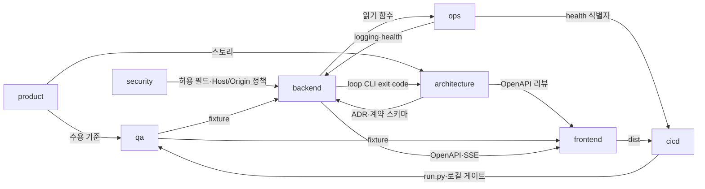

# 40. 팀 구성

> 입력: `aidlc/teams/catalog.json`, 10/20/30 분석서, user/01·02. core 팀(product, architecture, qa, cicd, ops, security)은 항상 생성.
> 생성한 팀마다 `workspace/teams/<id>/charter.md` 와 `.claude/agents/team-<id>.md` 가 존재한다.
> **1차 근거:** 20 §4 컴포넌트 표의 "소유 팀 (예정)" 칸 + 20 §4 끝의 "제안 팀" 문단, 30 §7 "데이터 팀 필요 여부".
> **규모 전제:** 1인 개발·2주 MVP(01 §7, §9). 팀은 실제 사람이 아니라 Agent 역할 분리이므로 "책임 경계가 겹치지 않는 최소 구성"을 목표로 한다.

## 1. 팀 구성 결정
| 팀 id | 팀명 | tier | 생성 근거 (분석서 § 인용) | 담당 컴포넌트/디렉토리 |
|-------|------|------|--------------------------|------------------------|
| product | Product (PO/PM) | core | 항상. 20 §4 "수용 기준 & KPI 사용 테스트 → product". 10 §6 MVP 성공 기준(KPI-01 질문 3개, KPI-02 설치 리허설), 10 §7 A10·A11 판정 기준 확인 | `workspace/project/stories/`, `workspace/project/uat/`, `monitor/README.md` |
| architecture | Architecture | core | 항상. 20 §4 "API 계약 & ADR → architecture", "aidlc-run 스킬 변경 → architecture". 20 §8 ADR 11건, 20 §5 파일 계약 F4·F5·F7 | `workspace/project/20-architecture-analysis.md`, `workspace/project/adr/`, `workspace/project/contracts/`(openapi.json 제외), `.claude/skills/aidlc-run/SKILL.md` |
| qa | QA / Test | core | 항상. 20 §4 "테스트 스위트 & fixture → qa". 02 §5 필수 테스트(일시정지/재개 시나리오, 깨진 파일·빈 workspace), 30 §6 "fixture 생성기·성능 테스트는 qa" | `monitor/backend/tests/{conftest.py, fixtures/, scenarios/, perf/}`, `monitor/frontend/tests/`, `workspace/project/qa/` |
| cicd | CI/CD (Build & Release) | core | 항상. 20 §4 "원클릭 런처 → cicd", "의존성 고정 & 빌드 산출물 관리 → cicd". 20 §6 PR 전 로컬 점검 스크립트. 원격 CI 는 01 §3 Out of scope 라 **로컬 게이트 스크립트**로 대체 | `run.py`, `run.bat`, `run.sh`, `monitor/backend/requirements*.txt`, `monitor/backend/pyproject.toml`, `monitor/frontend/package.json`·`package-lock.json`, `monitor/tools/`, `.gitignore`, `workspace/project/release/` |
| ops | Ops / SRE | core | 항상. 20 §4 "관측성 (`app/logging_config.py`, `api/health.py`) → ops". 20 §6 관측성(콘솔 로그 규칙, health), QS-03·QS-11 | `monitor/backend/app/logging_config.py`, `monitor/backend/app/api/health.py`, `monitor/backend/app/models/health.py`, `monitor/backend/tests/ops/`, `workspace/project/ops/` |
| security | Security / DevSecOps | core | 항상. 20 §4 "보안 정책 (허용 필드 목록, Host/Origin, `~/.claude` 접근 범위, 의존성 점검) → security". NFR-003, 00 Q2, QS-05·06·07, 30 §7 "개인정보 규칙은 security 리뷰" | `workspace/project/security/` (threat-model, privacy 허용 필드 체크리스트, security-checklist) |
| backend | Backend | conditional | create_when "서버 측 API 또는 도메인 로직 컴포넌트" 충족: 20 §4 API 앱 셸·AI-DLC 상태 리더·사용량 수집기·스냅샷 리더·status line 스크립트·SSE 허브·루프 제어 서비스·루프 제어 CLI 의 소유 팀이 모두 backend. 20 §5 엔드포인트 15개 | `monitor/backend/app/**`(ops 소유 3파일 제외), `monitor/backend/scripts/`, `monitor/backend/tests/{unit,api}/`, `aidlc/scripts/loop_control.py`, `aidlc/scripts/aidlc.py` 의 `loop-*` 서브커맨드 등록부, `aidlc/hooks/statusline.{sh,py}`, `.claude/settings.json` 의 `statusLine` 키, `workspace/project/contracts/openapi.json`(export 스크립트로만), `docs/api/`(재생성으로만) |
| frontend | Frontend | conditional | create_when "웹 UI" 충족: 01 §5.1 흐름 2~4 브라우저 대시보드, 20 §4 프론트 앱 셸·패널 컴포넌트·API 클라이언트의 소유 팀이 frontend. 02 §1 Vue 3 + Vite + ECharts | `monitor/frontend/src/**`(colocated `*.spec.ts` 포함), `monitor/frontend/dist/**`, `monitor/frontend/{index.html, vite.config.ts, tsconfig*.json, eslint.config.*, .prettierrc*}`, `workspace/project/design/` |

### 1.1 소유 경계 충돌 해소 (겹침 0 확인)
| 충돌 지점 | 문제 | 해소 |
|-----------|------|------|
| `/api/v1/health`·로깅 vs API 앱 셸 | 20 §4 는 관측성을 ops, 앱 셸(`main.py`)을 backend 로 둠. 둘 다 `monitor/backend/app/` 안 | **파일 단위로 분리.** ops = `app/logging_config.py`, `app/api/health.py`, `app/models/health.py` 3파일. backend = 그 밖의 `app/**`. `main.py` 에서 health 라우터 등록·`setup_logging()` 호출은 backend 가 하고, health 가 필요한 소스 상태·데우기 진행률은 backend 가 `services/` 의 읽기 함수(`source_status()`, `warmup.progress()`)로 제공 → ops 가 호출 |
| 테스트 디렉터리 (qa vs 개발 팀) | 20 §4 는 테스트 스위트 전체를 qa 로 두었지만, user/02 §10 공통 DoD("테스트 작성 및 통과")는 모든 Task 에 적용되고 카탈로그 qa `not_owns` 는 "단위 테스트 작성 책임(개발 팀)". 규칙 우선순위 user/02 > 분석서 | **하위 디렉터리로 분리.** backend = `monitor/backend/tests/unit/`, `tests/api/`. qa = `tests/conftest.py`, `tests/fixtures/`(가짜 workspace·JSONL·스냅샷 생성기), `tests/scenarios/`(일시정지/재개, 깨진 파일·빈 workspace, 해시 불변, 본문 비노출, Hook 규칙 대조), `tests/perf/`. ops = `tests/ops/`(health·로깅 단위). frontend = `src/**/*.spec.ts`(컴포넌트 단위). qa = `monitor/frontend/tests/`(fixture 응답·통합 spec). 개발 팀은 qa fixture 를 읽기만 하고, 새 fixture 가 필요하면 STM §5 `[qa]` 후보 |
| `workspace/project/contracts/openapi.json` | 카탈로그상 contracts/ 는 architecture 소유인데, 명세는 FastAPI 코드에서 export 되고 CLAUDE.md 는 "명세 수정 Task 안에서 재생성까지" 요구 | **파일 쓰기 = backend (export 스크립트 실행으로만, 손편집 금지), 계약 책임(A) = architecture.** API 를 바꾸는 backend Task 는 같은 Task 에서 `export_openapi.py` → `openapi_docs.py` 재생성까지 하고, architecture 리뷰 게이트가 하위 호환성을 판정. 파일 계약 스키마(`control`, `loop-status`, `claude-status`)와 `contracts/README.md` 는 architecture 소유 |
| 루프 제어 CLI vs 프레임워크 `aidlc.py` | `aidlc.py` 는 프레임워크 파일이고 20 §4 는 `loop-*` 서브커맨드 추가를 backend 로 둠 | backend 는 `aidlc/scripts/loop_control.py` 전체와 `aidlc.py` 의 `loop-*` 서브커맨드 **등록 블록만** 소유. 그 밖의 `aidlc.py`·`aidlc/hooks/memory_cascade.py` 는 어느 팀도 소유하지 않음(수정 필요 시 사용자 확인 질문) |
| `.claude/settings.json` | Hook 등록(프레임워크)과 `statusLine` 등록(ADR-003)이 한 파일 | backend 는 `statusLine` 키만 수정. `hooks` 등 다른 키는 무소유(수정 금지) |
| 프론트 의존성·빌드 설정 | 20 §4 는 package-lock·dist 신선도 검사를 cicd, 패널·앱 셸을 frontend 로 둠 | cicd = `package.json`·`package-lock.json`(의존성·scripts), `monitor/tools/check_dist_fresh.py`. frontend = 빌드 산출물 `dist/**`(`.build-meta.json` 포함)와 vite/tsconfig/eslint 설정. 의존성 추가는 ADR-007 범위 안에서 architecture 승인 후 cicd 가 반영 |
| `.gitignore` | 프레임워크 줄(`__pycache__/` 등)과 Monitor 줄이 섞임 | cicd 소유. 기존 프레임워크 줄은 지우지 않고 Monitor 항목(.venv, node_modules, `.control.json`, `.monitor/`)만 추가 |
| 사용자 가이드 | docs 팀 미생성 | `monitor/README.md`(설치·실행·사용 안내) = product. `/aidlc-docs` 산출물(`docs/` 중 `docs/aidlc`, `docs/api` 제외) = 오케스트레이터가 작성, 내용 검토 A = product |

## 2. 생성하지 않은 팀 & 책임 인수
| 후보 팀 | 제외 이유 (create_when 미충족 근거) | 책임을 넘겨받는 팀 |
|---------|-------------------------------------|-------------------|
| design | create_when "사용자 화면이 있고 흐름 3단계 이상" 은 문자 그대로는 경계선이다(01 §5.1 은 4단계). 그러나 4단계 중 1·3단계는 터미널·VS Code 에서 일어나고, 대시보드 안의 흐름은 **화면 1개, 페이지 이동 없음, 버튼 2개(일시정지/재개)** 다(20 §4 "design 은 화면 1개·흐름이 짧아 frontend 가 겸한다"). 시각 방향(Grafana 스타일 다크 테마, 12열 패널 그리드, 상단 KPI-01 행)은 이미 사용자 문서와 20 §4 프론트 앱 셸 행에 정해져 있다 | **frontend** (화면 명세 `workspace/project/design/dashboard.md`, 패널 empty/error/warming 상태 정의) + product (흐름이 수용 기준을 충족하는지 리뷰) |
| mobile | 01 §3 In scope 에 모바일 앱 없음. 로컬 브라우저 전용(01 §4 채널) | 없음 (범위 밖) |
| integration | create_when "외부 시스템 연동 2개 이상" 미충족. 외부 연동 대상은 Claude Code **1개**(JSONL 기록 + status line, 파일 2종, 20 §4 제안 팀 문단). 네트워크 연동 0개(QS-13) | **backend** (사용량 수집기 `services/usage/`, 스냅샷 리더, status line 스크립트) |
| dba | 운영 DB 없음. 03 §4 DB 서버 금지, 20 §3 "DB 없음", 30 §6 "DB 없이 프로세스 메모리만" | 없음. 메모리 캐시 구조는 **backend** |
| data | 30 §7 "별도 data/analytics/ml/dba 팀은 필요 없다" — 30일 수백 MB 를 표준 라이브러리로 1초대 파싱, ETL 인프라 금지, 정제 규칙 단순 | **backend** (수집·정제·집계 `services/usage/`), **security** (허용 필드 규칙 리뷰), **qa** (fixture 생성기·성능 테스트) |
| analytics | 30 §7 동일 결론. KPI-01·02 는 사람이 스톱워치·리허설로 측정(10 §3, 30 §7 "데이터로 자동 측정하지 않는다"). 이 제품 자체가 대시보드지만 비즈니스 KPI 대시보드·정기 리포트는 범위 밖 | **product** (KPI-01 사용 테스트, KPI-02 설치 리허설 기록 `workspace/project/uat/`) |
| ml | 04 §5 ML/AI 미사용, 30 §7 (3). LLM 프롬프트·RAG·모델 없음 | 없음. 단, 스킬 프롬프트(`.claude/skills/aidlc-run/SKILL.md`) 변경은 **architecture** |
| infra | create_when "클라우드/서버 리소스·네트워크·IaC" 미충족. 02 §1 Infra "N/A (로컬 실행, 인프라 없음)", 20 §6 "서버·클라우드·컨테이너·DB 없음", 03 §4·§6 | **ops** (로컬 실행 환경 전제: 포트·127.0.0.1 바인딩 운영 확인, 런북) + **cicd** (venv·설치를 처리하는 런처) |
| docs | create_when "외부 공개 API, 운영자 매뉴얼, 사용자 가이드" 미충족. API 는 127.0.0.1 전용이라 공개 API 아님(NFR-003), 레퍼런스는 `openapi_docs.py` 가 자동 생성. 설치·사용 안내는 10 §2 "docs/ 와 대시보드 안내 문구로 대체" 수준 | 카탈로그 규칙대로 `/aidlc-docs` 는 **오케스트레이터**가 직접 수행. 내용 책임(A)은 **product** (`monitor/README.md` 사용 안내, 기능 설명), API 레퍼런스 재생성은 **backend**(명세 변경 Task 안에서), 계약 정확성은 **architecture** |

## 3. 조직도
```mermaid
flowchart TB
  subgraph 기획·설계
    product["product (core)<br/>스토리·수용 기준·UAT·README"]
    architecture["architecture (core)<br/>ADR·계약·aidlc-run 스킬"]
  end
  subgraph 개발
    backend["backend<br/>FastAPI·수집기·SSE·루프 제어 CLI·statusline"]
    frontend["frontend<br/>Vue 대시보드·dist·화면 명세(design 인수)"]
  end
  subgraph 데이터·AI
    nodata["(생성 안 함 — 30 §7)<br/>data/analytics/ml → backend·qa·security·product"]
  end
  subgraph 품질
    qa["qa (core)<br/>fixture·시나리오·성능 테스트"]
  end
  subgraph 플랫폼·운영
    cicd["cicd (core)<br/>run.py·의존성 고정·로컬 게이트"]
    ops["ops (core)<br/>로깅·health·런북 (infra 인수)"]
  end
  subgraph 보안·거버넌스
    security["security (core)<br/>위협 모델·허용 필드·Host/Origin"]
    nodocs["(docs 생성 안 함)<br/>/aidlc-docs → 오케스트레이터 + product"]
  end
  product --> architecture
  architecture --> backend & frontend
  qa -.리뷰.-> backend & frontend
  security -.리뷰.-> backend
```

## 4. 책임 매트릭스 (RACI)
<!-- 열 = 생성된 팀 id. R=수행, A=최종책임(정확히 1팀), C=협의, I=통보 -->
| 산출물/활동 | product | architecture | qa | cicd | ops | security | backend | frontend |
|-------------|---------|--------------|----|------|-----|----------|---------|----------|
| 요구사항·수용 기준 (`stories/`) | A/R | C | C | I | I | I | I | I |
| KPI-01 사용 테스트·KPI-02 설치 리허설 (`uat/`) | A/R | I | C | C | I | I | I | C |
| 단계 판정(A11)·cascade 막힘(A10) 기준 확정 | A | C | C | I | I | I | R | I |
| ADR·계약 (ADR 전체, 파일 계약 스키마) | I | A/R | C | C | C | C | C | C |
| OpenAPI 계약 (`contracts/openapi.json` + `docs/api` 재생성) | I | A | C | I | I | C | R | C |
| 화면 명세 (`design/`, design 인수) | C | C | I | I | I | I | I | A/R |
| 기능 구현 — API·서비스 (`monitor/backend/app`) | C | C | C | I | C | C | A/R | I |
| 기능 구현 — 대시보드 UI (`monitor/frontend/src`) | C | C | C | I | I | I | C | A/R |
| 사용량 수집기 (`services/usage/`) | I | C | C | I | I | C | A/R | I |
| status line 스크립트 (`aidlc/hooks/statusline.*` + `statusLine` 등록) | I | C | C | I | C | C | A/R | I |
| 루프 제어 CLI (`aidlc/scripts/loop_control.py`, `aidlc.py loop-*`) | I | C | C | I | C | I | A/R | I |
| aidlc-run 스킬 변경 (`.claude/skills/aidlc-run/SKILL.md`) | C | A/R | C | I | C | I | C | I |
| 개인정보 허용 필드 목록 (`security/privacy.md` 체크리스트) | I | C | C | I | I | A/R | C | I |
| 허용 필드 필터 구현 (`services/usage/privacy_filter.py`) | I | I | C | I | I | C | A/R | I |
| 테스트 전략·fixture·시나리오·성능 테스트 | C | I | A/R | C | I | C | C | C |
| backend 단위·API 테스트 (`monitor/backend/tests/unit`, `tests/api`) | I | I | C | I | I | I | A/R | I |
| frontend 컴포넌트 단위 테스트 (`monitor/frontend/src/**/*.spec.ts`) | I | I | C | I | I | I | I | A/R |
| 런처 (`run.py`, `run.bat`, `run.sh`) | C | C | C | A/R | C | C | I | I |
| 의존성 고정 (`requirements*.txt`, `package*.json`) | I | C | I | A/R | I | C | C | C |
| dist 빌드·커밋 (`monitor/frontend/dist`) | I | I | C | C | I | I | I | A/R |
| dist 신선도 검사·로컬 PR 게이트 (`monitor/tools/`) | I | I | C | A/R | I | I | C | C |
| CI/CD·릴리스 (릴리스 절차, pip-audit/npm audit 실행) | I | I | C | A/R | C | C | I | I |
| 로깅 설정·health (`logging_config.py`, `api/health.py`, `tests/ops/`) | I | C | C | C | A/R | C | C | I |
| 운영·SLO·장애 대응 (`ops/` 런북) | I | I | C | C | A/R | C | C | I |
| 보안·개인정보 (위협 모델, Host/Origin 정책) | I | C | C | C | I | A/R | C | I |
| 사용자 가이드 (`monitor/README.md`, `/aidlc-docs` 내용 검토) | A/R | C | I | C | C | I | C | C |

검증: 모든 행에 A 가 정확히 1개 (26행 / A 26개).

## 5. 리뷰 게이트
<!-- /aidlc-run 이 Task 완료 후 대상에 해당하면 해당 팀을 리뷰 모드로 호출. catalog.json 의 review_gate 기준 -->
리뷰 게이트를 운영하는 팀은 생성된 8팀 중 6팀(core 전원). backend·frontend 는 카탈로그상 review_gate 없음.

| 리뷰 팀 | 적용 대상 Task | 주요 확인 항목 |
|---------|---------------|---------------|
| qa | 코드를 변경하는 **모든** Task (항상 필수) | DoD(user/02 §10 + 팀 DoD) 충족 / 수용 기준 대응 테스트를 실제 실행해 통과 / 회귀 없음 / 엣지·오류 케이스(깨진 파일·빈 workspace·스냅샷 없음) |
| product | FR 의 동작을 바꾸는 모든 Task (FR-001~010, SCOPE-01) | 결과가 FR 수용 기준 충족 / In·Out scope 이탈 없음(01 §3: 화면에서 문서 편집 금지 등) |
| architecture | 새 컴포넌트·외부 의존성·데이터 모델·팀 간 계약을 바꾸는 Task (openapi.json, 파일 계약 3종, `aidlc.py loop-*` exit code, SKILL.md, 의존성 추가) | ADR 존재 / user/03 원칙·금지 기술 준수 / 계약 하위 호환성 |
| cicd | 빌드 설정·의존성·CI(로컬 게이트) 워크플로를 바꾸는 Task (requirements, package*.json, vite/tsconfig, run.*, `monitor/tools/`) | 로컬 게이트 통과 / 빌드 재현성(버전 고정, lock, dist 신선도) |
| ops | 배포(실행) 방식·설정·로그 계측·외부 의존성을 바꾸는 Task (런처, 포트·경로 설정, 로그 출력, health, statusLine 등록) | 관측 가능(로그 레벨 규칙, health 반영) / 롤백 가능(파일 되돌리기로 원복) / NFR-001·002 영향 평가 |
| security | 인증·인가·입력 처리·개인정보·비밀값·외부 노출 엔드포인트·AI 프롬프트 입력을 다루는 Task (사용량 수집기, status line 스크립트, Host/Origin 가드, `POST /control/*`, `~/.claude` 접근, 로그 문구) | OWASP Top 10 관점 취약점 없음 / 대화 본문·ID·경로 비노출(허용 필드 체크리스트) / 최소 권한(쓰기 = `.control.json` 1개, `~/.claude` 읽기 범위) |

## 6. 팀 간 인터페이스 (계약)
| 제공 팀 → 사용 팀 | 인터페이스 | 형식 | 계약 문서 위치 |
|-------------------|-----------|------|----------------|
| backend → frontend | 조회 REST `/api/v1/*` + 공통 봉투 `{data, meta}` + 에러 포맷 (20 §5 F1) | OpenAPI 3.1 | `workspace/project/contracts/openapi.json`, `docs/api/reference.md` |
| backend → frontend | SSE `GET /api/v1/events` (`changed`/`warming`/`ready`, keep-alive) (F2) | 이벤트 스키마(Markdown) | `workspace/project/contracts/sse-events.md` |
| backend(API) → backend(CLI) / aidlc-run | `.control.json` (F4, 쓰기 = 대시보드만) | JSON Schema | `workspace/project/contracts/control.schema.json` |
| backend(CLI) → backend(API) | `loop-status.json` (F5, 쓰기 = CLI 만) | JSON Schema | `workspace/project/contracts/loop-status.schema.json` |
| backend(CLI) → architecture(SKILL.md) | `aidlc.py loop-start/loop-check/wait-resume/loop-end` exit code 0/2/10/20 (F6) | CLI 계약(Markdown) | `workspace/project/contracts/loop-cli.md`, ADR-004 |
| backend(statusline) → backend(스냅샷 리더) | `claude-status.json` (F7) | JSON Schema | `workspace/project/contracts/claude-status.schema.json`, ADR-003 |
| backend → ops | 소스 상태·데우기 진행률 읽기 함수 (health 용) | Python 함수 시그니처 | `workspace/project/contracts/README.md` (내부 인터페이스 절) |
| ops → backend | `setup_logging()`, 로그 문구 규칙(본문·경로·ID 금지) | Python 모듈 + 규칙 | `monitor/backend/app/logging_config.py`, `workspace/project/ops/logging.md` |
| ops → cicd | `/api/v1/health` 의 `app: "aidlc-monitor"` 식별자(런처 중복 실행 판정) | OpenAPI | `contracts/openapi.json` (`HealthResponse`) |
| qa → backend, frontend | fixture 생성기(가짜 workspace·JSONL·스냅샷), 본문 표식 문자열 | Python 모듈 / JSON | `monitor/backend/tests/fixtures/`, `monitor/frontend/tests/fixtures/`, `workspace/project/qa/test-strategy.md` |
| security → backend, qa | 허용 필드 목록·`~/.claude` 접근 범위·Host/Origin 정책 체크리스트 | 체크리스트(Markdown) | `workspace/project/security/privacy.md`, `security-checklist.md` |
| product → qa, frontend | FR 별 Given/When/Then, KPI-01 질문 3개 | 스토리(Markdown) | `workspace/project/stories/FR-xxx.md` |
| frontend → cicd | `npm run build` 산출물 + `dist/.build-meta.json`(소스 해시) | 파일 | `monitor/frontend/dist/`, ADR-005 |
| cicd → 모든 개발 팀 | 로컬 게이트 명령(ruff·pytest·eslint·vue-tsc·vitest·dist 신선도·OpenAPI diff) | 스크립트 | `monitor/tools/check.py`, `workspace/project/release/release.md` |

## 7. 팀 의존 그래프

병목 주의: backend 가 컴포넌트 9개를 가져 Task 가 몰린다(1인 개발 전제상 의도된 집중). P1 초반 스파이크 2건(R-01 대기 루프, R-02 statusLine)은 backend Task, 그 결과를 architecture 가 ADR-004·003 에 반영한다.

## 8. 팀별 초기 책임 FR / NFR
| 팀 | FR / NFR | 첫 Phase 목표 (P1 = M1, 2026-11-06) |
|----|---------|---------------|
| product | FR-001~010·SCOPE-01 수용 기준 소유, KPI-01·02, A10·A11 | P1 스토리 6건(FR-001~005, SCOPE-01) + UAT 체크리스트, A11 단계 판정 기준 확정 |
| architecture | FR-005 (스킬 변경), FR-008 (SSE 계약), CON-04 OpenAPI, NFR-004·005 N/A 유지 | 파일 계약 스키마 3종 + `loop-cli.md`, SKILL.md 루프 경계 로직, R-01 스파이크 결과로 ADR-004 확정 |
| qa | NFR-001 성능, NFR-002 깨진 입력, FR-005 시나리오, CON-03 해시 불변, FR-003 Hook 규칙 대조 | 테스트 전략 + fixture 생성기(빈/일부/전체/깨짐/closed STM, 30일 JSONL) + 일시정지/재개 시나리오 |
| cicd | SCOPE-01, KPI-02, 02 §4 dist 동봉, 02 §9 버전 고정 | `run.py`/`run.bat`/`run.sh`, requirements 고정, `.gitignore`, 로컬 게이트·dist 신선도 검사 |
| ops | CON-05 health, 02 §7 로깅, NFR-002(서버 생존), QS-11 heartbeat 만료 표시 | `logging_config.py`, `/api/v1/health`, 런북(포트 사용 중·statusLine 미실행·일시정지 해제 안 됨) |
| security | NFR-003, CON-07, 00 Q2 허용 필드, QS-05·06·07 | 위협 모델(STRIDE) + privacy.md 허용 필드 체크리스트 + Host/Origin 정책, P1 FR-004 리뷰 |
| backend | FR-001, FR-002, FR-003, FR-004, FR-005, FR-008(서버), CON-01·02·03 / P2: FR-006, FR-007, FR-009, FR-010 | API 앱 셸 + 상태 리더 + 사용량 수집기 + status line + 루프 제어 API·CLI + SSE(M1 topic), 라인 커버리지 ≥ 70% |
| frontend | FR-001~005 패널, FR-008(클라이언트), FR-010 배너 / P2: FR-006, FR-007, FR-009 패널, FR-008 전 패널 | 다크 테마 레이아웃 + Pipeline/Plan/Task/Memory/사용량/제어 패널 + EventSource 구독 + dist 커밋 |

FR 배정 확인: FR-001~010, SCOPE-01 모두 최소 1개 구현 팀(backend 또는 frontend 또는 cicd)과 수용 책임 product 에 배정됨. NFR-001~003 = qa·security·ops, NFR-004·005(N/A) = architecture.
